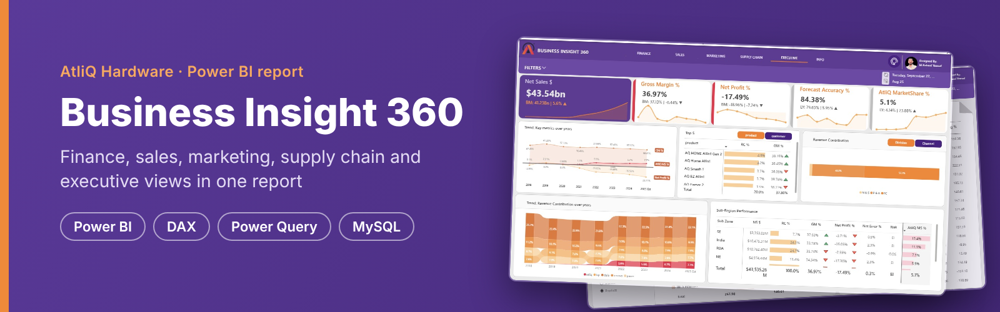
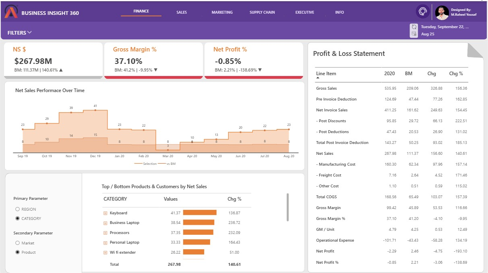
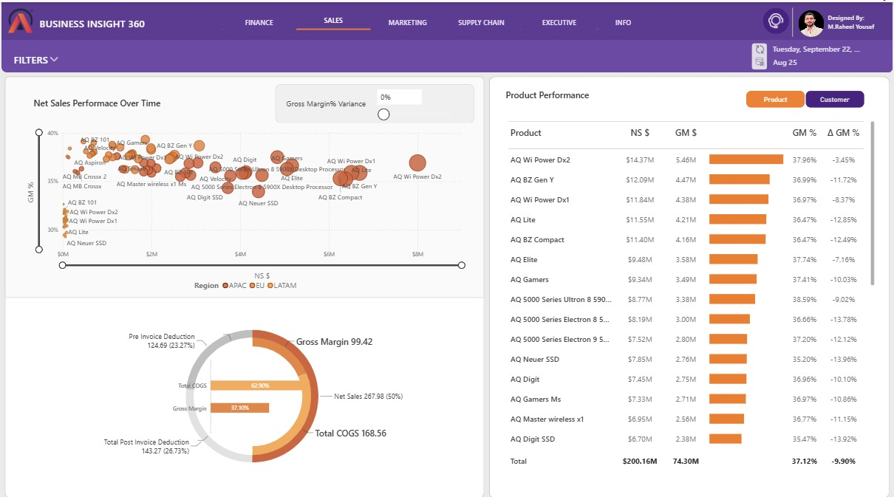
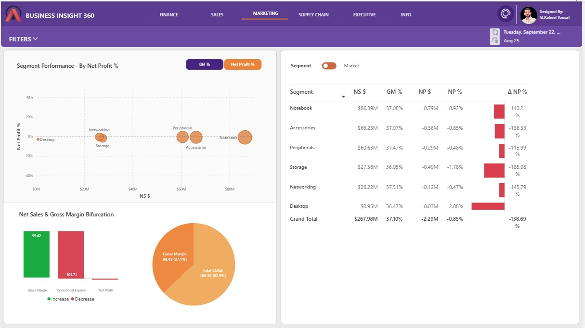
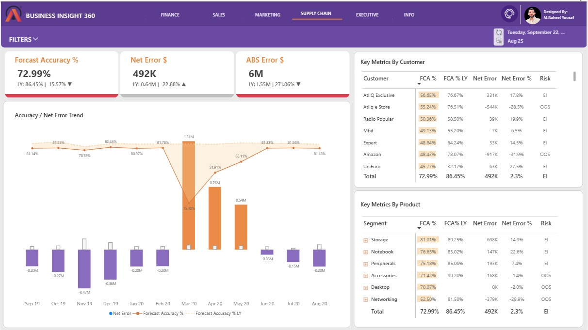
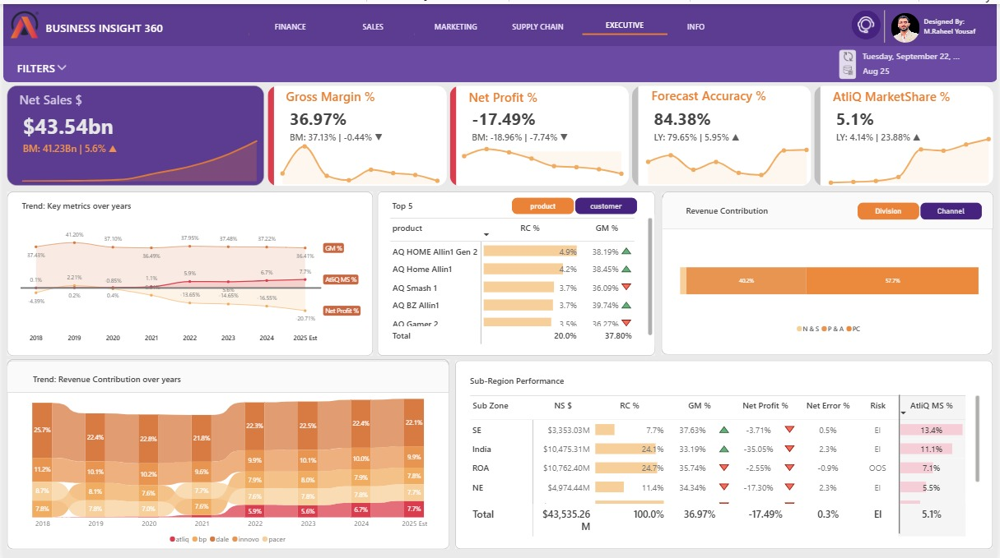
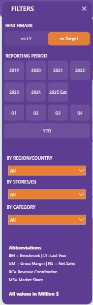
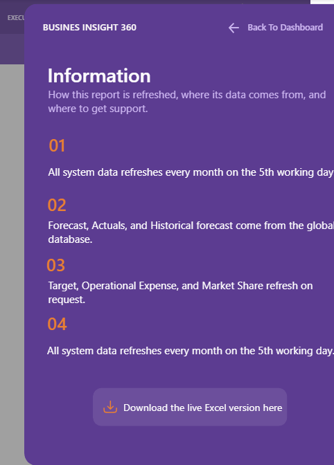

[Context](#business-context) · [Journey](#project-journey) · [Insights](#key-insights) · [Questions](#business-questions) · [Data model](#data-model) · [Skills](#skills-demonstrated) · [Gallery](#screenshot-gallery) · [Repository](#repository-structure) · [Author](#about-the-author)

# Business Insight 360

**A five-view Power BI report that gives AtliQ Hardware one place to track its P&L, sales, profitability, forecast accuracy and market share.**

[](https://app.powerbi.com/view?r=eyJrIjoiNTNjYjkzZDYtNjc1ZC00ZWI5LTgzYTQtM2QxNTAwNjFiODg3IiwidCI6ImM2ZTU0OWIzLTVmNDUtNDAzMi1hYWU5LWQ0MjQ0ZGM1YjJjNCJ9)

---

## Business context

AtliQ Hardware sells computer hardware and accessories in 27 markets across four regions (APAC, EU, LATAM and NA). Its analysis was spread across Excel files. Each team needed its own view of the same trusted numbers.

| Team | Question the report answers |
|---|---|
| Finance | How does our P&L compare with last year or target? |
| Sales | Which customers and products earn the most, and at what margin? |
| Marketing | Which segments and markets are profitable after operating expenses? |
| Supply chain | How accurate is our demand forecast, and where is the stock risk? |
| Leadership | How are sales, profit and market share trending against competitors? |

---

## Project journey

| Phase | What was done | Result |
|---|---|---|
| 1. Check the data | Loaded the data into MySQL and ran queries to check it | Clean starting point for the report |
| 2. Prepare | Connected Power BI to MySQL, combined actuals with the remaining forecast, built a fiscal date table (September to August) | One fact table covering actuals and estimates |
| 3. Calculate | Built the P&L chain from gross sales to net profit with Power Query steps and DAX calculated columns, then wrote the measures | Gross sales, deductions, costs, gross margin and net profit for every sales row |
| 4. Extend | Added operating expenses, targets and market share from Excel | Net profit, target benchmarks and competitor comparison |
| 5. Design | Built a home page, five views, a filter panel, bookmarks, toggles and dynamic titles | One report for five teams |
| 6. Optimise and publish | Reduced the file size with DAX Studio and published to Power BI Service | Live, shareable dashboard |

---

## Key insights

| Finding | Evidence | Period |
|---|---|---|
| Sales grew but profit did not | Net sales $267.98M, 140.61% above the benchmark of $111.37M, yet net profit was -$2.29M (-0.85%) | FY2020 |
| Operating costs erased the margin | Operational expense of $101.71M was higher than gross margin of $99.42M | FY2020 |
| No segment made a profit | All six segments had a negative net profit %, from -0.47% (Networking) to -2.88% (Desktop) | FY2020 |
| Margin slipped against benchmark | Gross margin was 37.10% against a benchmark of 41.20% | FY2020 |
| Forecast accuracy fell | 72.99% against 86.45% last year, with a low of 15.40% in March 2020 | FY2020 |
| Market share grew steadily | AtliQ's share rose from 0.1% in 2018 to an estimated 7.7% in 2025 | 2018 to 2025 Est |
| Two sub-zones carry the business | India and ROA together bring 48.8% of net sales; India's net profit is -35.05% | 2018 to 2025 Est |

FY2020 runs from September 2019 to August 2020. Full tables are in [docs/business_answers.md](docs/business_answers.md).

---

## Business questions

| # | View | Question | Answer |
|---|---|---|---|
| 1 | Finance | How does the P&L compare with the benchmark? | [Answer](docs/business_answers.md#1-finance) |
| 2 | Sales | Which products earn the most, and at what margin? | [Answer](docs/business_answers.md#2-sales) |
| 3 | Marketing | Which segments are profitable after operating expenses? | [Answer](docs/business_answers.md#3-marketing) |
| 4 | Supply chain | How accurate is the forecast, and where is the stock risk? | [Answer](docs/business_answers.md#4-supply-chain) |
| 5 | Executive | How are sales, profit and market share trending? | [Answer](docs/business_answers.md#5-executive) |

How each view was built, with the DAX behind it: [docs/walkthrough.md](docs/walkthrough.md)

---

## Data model

Star-style model with two fact tables, `fact_actuals_estimates` and `fact_forecast_monthly`, filtered by shared dimensions.

```
                 dim_customer      dim_product      dim_date
                      |                 |               |
         +------------+--------+--------+-------+-------+
         |                     |                |
 fact_actuals_estimates  fact_forecast_monthly  post_invoice_deductions

 dim_customer -> dim_market -> sub_zone
 dim_product  -> category
 dim_date     -> fiscal_year
```

| Lookup table | Linked to | Used for |
|---|---|---|
| `post_invoice_deductions` | customer, product, date | Post-invoice discount % |
| `manufacturing_cost` | product, fiscal year | Unit manufacturing cost |
| `freight_cost` | market, fiscal year | Freight and other cost % |
| `Operational Expense` | market, fiscal year | Ads and other operating expense % |
| `NsGmTarget` | market, date | Net sales, gross margin and net profit targets |
| `marketshare` | sub-zone, category, fiscal year | Market share against competitors |

### From gross sales to net profit

```
Gross sales                  = Qty x gross price                       (Power Query)
- Pre-invoice deduction      = gross sales x customer discount %       (Power Query)
= Net invoice sales
- Post-invoice deductions    = net invoice sales x deduction %         (DAX column)
= Net sales
- COGS                       = manufacturing + freight + other cost    (DAX columns)
= Gross margin
- Operational expense        = net sales x (ads % + other opex %)      (DAX columns)
= Net profit
```

### Actuals and forecast

```
fact_sales_monthly  (actuals up to the last sales month)
        +
Remaining Forecast  (forecast for the months after it)
        =
fact_actuals_estimates  (full year: actuals plus estimates)
```

### Forecast accuracy

```
Net Error           = Forecast Qty - Sales Qty
ABS Error           = sum of |Net Error| by month and product
Forecast Accuracy % = 1 - ABS Error / Forecast Qty
Risk                = EI (excess inventory) if Net Error > 0, OOS (out of stock) if < 0
```

---

## Skills demonstrated

| Area | What was used |
|---|---|
| Data sourcing | MySQL database, queries to check the data, Excel sources |
| Power Query (M) | Merges, appends, unpivot, custom columns, a generated date table |
| Data modelling | Star-style model, one-to-many relationships, supporting and calculated tables |
| DAX | Measures, calculated columns and tables, time intelligence (`SAMEPERIODLASTYEAR`), `SWITCH`, `RANKX`, `TREATAS`, iterators (`SUMX`) |
| Report design | Home page, page navigation, filter panel, bookmarks, field parameters, dynamic titles, tooltips, conditional formatting |
| Visuals | KPI cards, P&L matrix, scatter, waterfall, donut, ribbon and line and column charts |
| Performance | File size reduced with DAX Studio |
| Delivery | Published and shared through Power BI Service |
| Business | P&L, unit economics, forecast accuracy, market share |

---

## Screenshot gallery

| | |
|---|---|
| [](images/01_home.jpg) Home | [](images/03_finance.jpg) Finance |
| [](images/04_sales.jpg) Sales | [](images/05_marketing.jpg) Marketing |
| [](images/06_supply_chain.jpg) Supply chain | [](images/07_executive.jpg) Executive |
| [](images/02_filter_panel.jpg) Filter panel | [](images/08_information.png) Information |

---

## Repository structure

```
Business-Insight-360/
|-- README.md
|-- .gitignore
|-- .gitattributes
|-- docs/
|   |-- walkthrough.md          how each view was built, with DAX
|   `-- business_answers.md     full answer tables for each view
|-- power-query/                Power Query (M) steps, in build order
|-- dax/
|   |-- measures.dax            business measures
|   |-- ui_measures.dax         KPI labels, dynamic titles, colours
|   |-- calculated_columns.dax
|   `-- calculated_tables.dax
`-- images/                     report screenshots
```

### How to rebuild it

1. Load the source tables into MySQL as two databases: `gdb041` (sales, forecast, customers, products, markets) and `gdb056` (prices, deductions, costs).
2. In Power BI Desktop, connect to MySQL and recreate the queries in [`power-query/`](power-query) in numbered order.
3. Create a text parameter `SourceFolder` pointing to the folder with the Excel files (operating expenses, targets, market share).
4. Add the calculated columns and tables from [`dax/`](dax), then the measures.
5. Set the relationships shown in the [data model](#data-model).

The `.pbix` file and source data are not included because of their size.

---

## About the author

**Muhammad Raheel Yousaf**, Data Analyst

[](https://github.com/mraheelyousaf4)
[](https://www.linkedin.com/in/muhammad-raheel-yousaf-da/)

---

## Acknowledgement

AtliQ Hardware is a fictional company. The data was created for practice and does not describe a real business.
