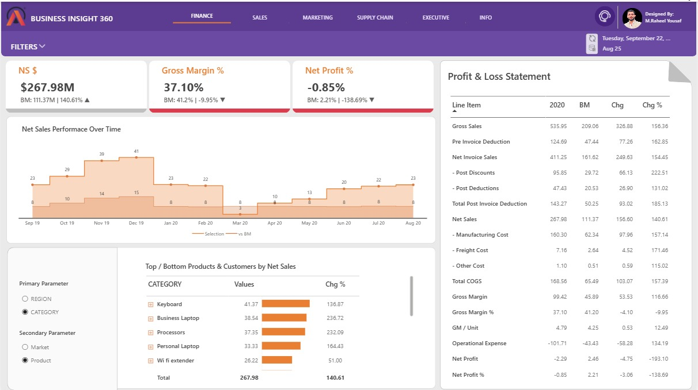
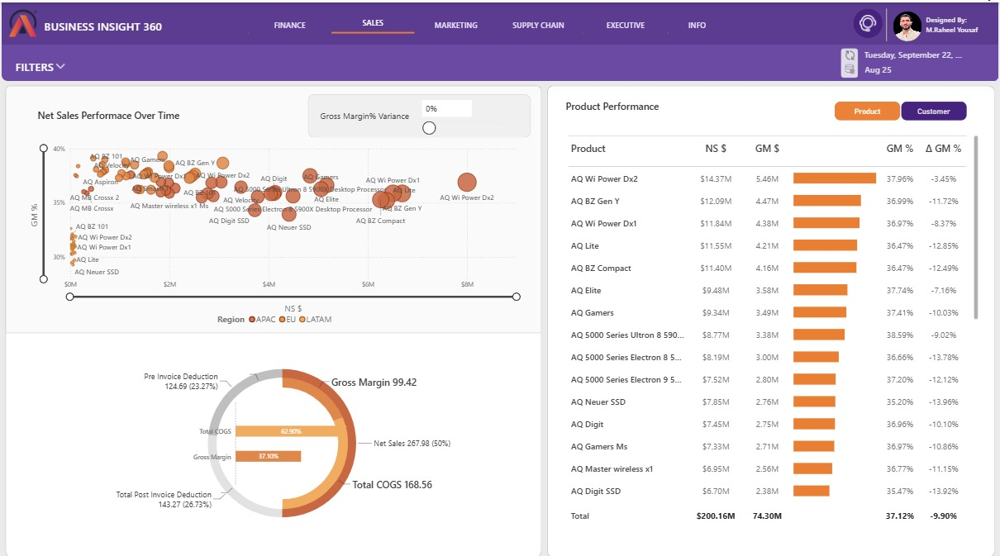
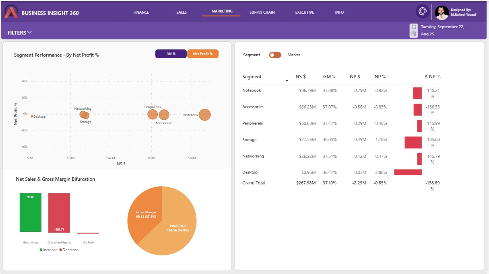
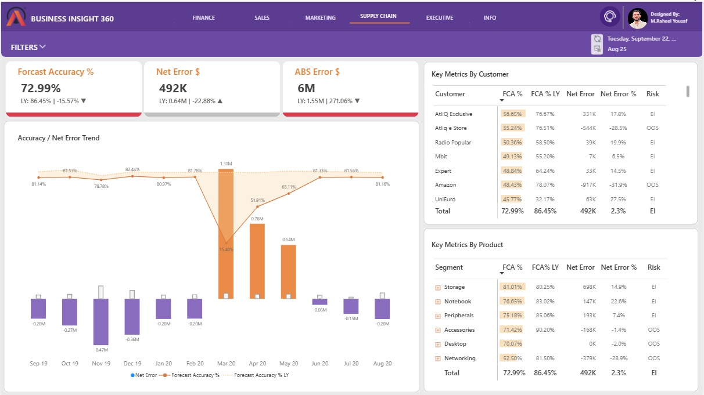
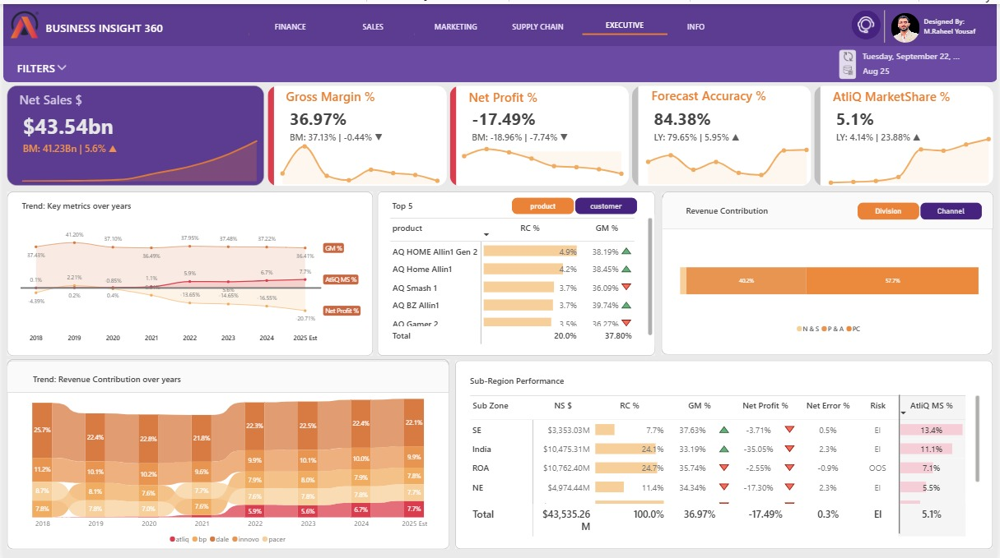
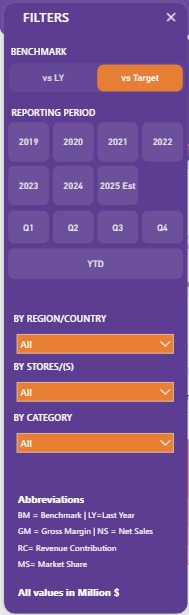
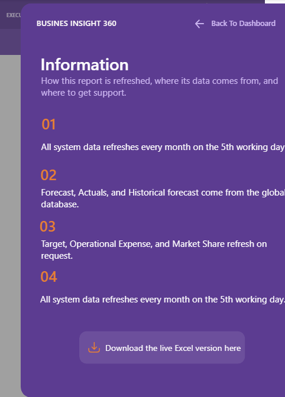

# Walkthrough

How each part of the report was built, and the DAX behind it. Full answer tables are in [business_answers.md](business_answers.md).

[Data preparation](#data-preparation) · [Finance](#1-finance) · [Sales](#2-sales) · [Marketing](#3-marketing) · [Supply chain](#4-supply-chain) · [Executive](#5-executive) · [Navigation](#navigation-and-filters)

---

## Data preparation

1. **Loaded the data into MySQL** and ran queries to check it before building the report.
2. **Connected Power BI to MySQL** and loaded the sales, forecast, price, deduction, cost and customer tables.
3. **Combined actuals and forecast** into one fact table. Months after the last actual sales month come from the forecast, so the current year shows actuals plus estimates. See [`03_remaining_forecast.pq`](../power-query/03_remaining_forecast.pq) and [`05_fact_actuals_estimates.pq`](../power-query/05_fact_actuals_estimates.pq).
4. **Added the fiscal year.** AtliQ's year runs September to August, so the fiscal year is the date plus 4 months.
5. **Calculated gross sales and net invoice sales in Power Query** by merging the gross price and pre-invoice discount tables.
6. **Calculated net sales, costs and operating expenses as DAX calculated columns**, each from a % lookup table. See [`calculated_columns.dax`](../dax/calculated_columns.dax).
7. **Built a date table** in Power Query with fiscal month, quarter and YTD/YTG flags. See [`06_dim_date.pq`](../power-query/06_dim_date.pq).
8. **Added supplementary data** from Excel: operating expenses, net sales and margin targets, and market share.
9. **Reduced the file size** using DAX Studio.

---

## 1. Finance



**Question:** How does the P&L compare with the benchmark?

**Approach:** A P&L table driven by two small tables, `P & L Rows` (17 line items) and `P & L Columns` (year, BM, Chg, Chg %). One measure returns the right figure for each cell.

```dax
P & L Final Value =
SWITCH (
    TRUE (),
    SELECTEDVALUE ( fiscal_year[fy_desc] ) = MAX ( 'P & L Columns'[Col Header] ), [P & L values],
    MAX ( 'P & L Columns'[Col Header] ) = "BM", [P & L BM],
    MAX ( 'P & L Columns'[Col Header] ) = "Chg", [P & L Chg],
    MAX ( 'P & L Columns'[Col Header] ) = "Chg %", [P & L Chg %]
)
```

The benchmark switches between last year and target:

```dax
NS BM $ =
SWITCH (
    TRUE (),
    SELECTEDVALUE ( 'Set BM'[ID] ) = 1, [NS $ LY],
    SELECTEDVALUE ( 'Set BM'[ID] ) = 2, [NS Target $]
)
```

**Answer (FY2020):** Net sales of $267.98M were 140.61% above benchmark, but net profit was -0.85% because operational expense ($101.71M) exceeded gross margin ($99.42M).

---

## 2. Sales



**Question:** Which products and customers earn the most, and at what margin?

**Approach:** A scatter chart of net sales against gross margin % by product, coloured by region. A slider filters products whose margin falls short of the benchmark by more than the chosen gap.

```dax
GM % Variance = [GM % BM] - [GM %]

GM % Filter =
IF ( [GM % Variance] >= SELECTEDVALUE ( 'Target Gap Tolerance'[Target Gap Tolerance] ), 1, 0 )
```

A toggle switches the table between products and customers, and the title follows the toggle.

**Answer (FY2020):** AQ Wi Power Dx2 led with $14.37M of net sales at 37.96% gross margin.

---

## 3. Marketing



**Question:** Which segments are profitable after operating expenses?

**Approach:** A segment and market table with net profit, a performance matrix that switches between GM % and net profit %, and a waterfall from gross margin to net profit.

```dax
Operational Expense $ = ( [Ads & Promotions $] + [Other Operational Expense $] ) * -1

Net Profit $ = [GM $] + [Operational Expense $]

Net Profit % = DIVIDE ( [Net Profit $], [NS $], 0 )
```

**Answer (FY2020):** All six segments had a negative net profit %. Desktop was lowest at -2.88%.

---

## 4. Supply chain



**Question:** How accurate is the forecast, and where is the stock risk?

**Approach:** Forecast accuracy is based on absolute error, summed at month and product level so over- and under-forecasts do not cancel out.

```dax
Net Error = [Forecast Qty] - [Sales Qty]

ABS Error =
SUMX (
    DISTINCT ( dim_date[month] ),
    SUMX ( DISTINCT ( dim_product[product_code] ), ABS ( [Net Error] ) )
)

Forecast Accuracy % = IF ( [ABS Error %] <> BLANK (), 1 - [ABS Error %], BLANK () )

Risk = IF ( [Net Error] > 0, "EI", IF ( [Net Error] < 0, "OOS", BLANK () ) )
```

**Answer (FY2020):** Forecast accuracy fell from 86.45% to 72.99%, with a low of 15.40% in March 2020.

---

## 5. Executive



**Question:** How are sales, profit and market share trending?

**Approach:** The market share source has one column per manufacturer. Power Query unpivots it into one row per manufacturer, so one measure works for AtliQ and every competitor. See [`07_marketshare.pq`](../power-query/07_marketshare.pq).

```dax
Market Share % =
DIVIDE ( SUM ( marketshare[sales_$] ), SUM ( marketshare[total_market_sales_$] ), 0 )

AtliQ MS % = CALCULATE ( [Market Share %], marketshare[manufacturer] = "atliq" )

AtliQ MS % LY =
CALCULATE (
    [AtliQ MS %],
    TREATAS ( VALUES ( fiscal_year[prior_fiscal_year] ), fiscal_year[fiscal_year] )
)
```

**Answer (all years, 2018 to 2025 estimate):** AtliQ's market share rose from 0.1% in 2018 to an estimated 7.7% in 2025, while net profit across all years was -17.49%.

---

## Navigation and filters

| Home page | Filter panel | Information page |
|---|---|---|
|  |  |  |

- The home page links to each view and shows the last refresh date and the month sales data is loaded to.
- Bookmarks drive the report's interactive elements.
- The filter panel sets the benchmark (last year or target), the period (fiscal year, quarter or YTD), region, store and category.
- KPI cards use text measures to show the benchmark and the change with an arrow, for example `BM: 111.37M | 140.61% ▲`. See [`ui_measures.dax`](../dax/ui_measures.dax).
